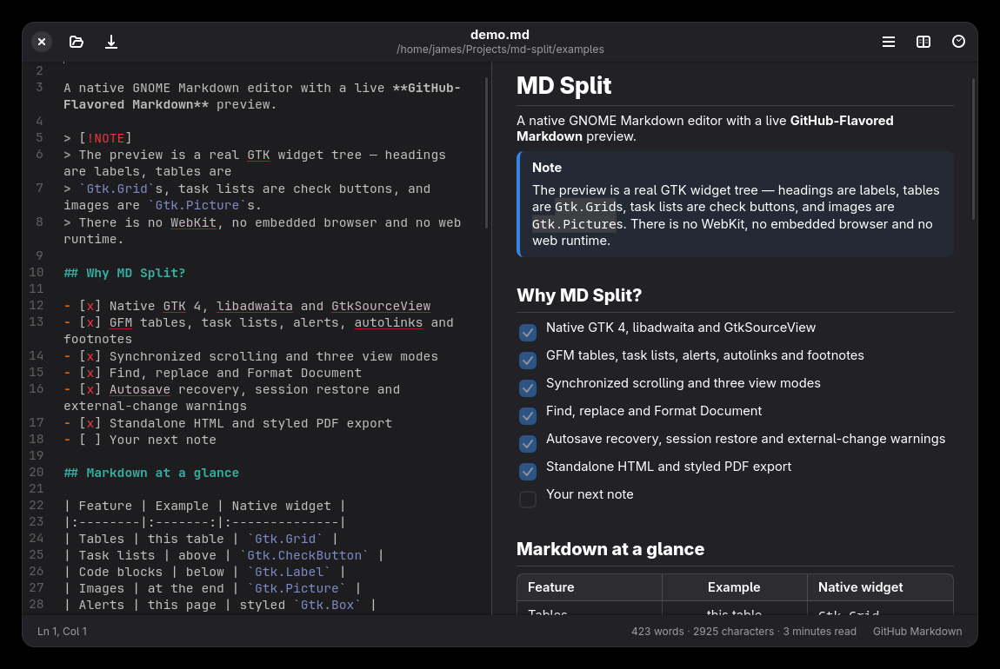

# MD Split

A native GNOME Markdown editor with a live, GitHub-Flavored Markdown preview.



MD Split is built with GTK 4, libadwaita and GtkSourceView. The preview is a
real GTK widget tree — headings are labels, tables are `Gtk.Grid`s, task lists
are check buttons, code blocks are selectable monospace labels, and images are
`Gtk.Picture`s. There is no WebKit, no embedded browser and no web runtime.

Markdown parsing is done by [markdown-it-py](https://github.com/executablebooks/markdown-it-py)
with its composite GFM plugin. Both are vendored under `src/vendor`, so the app
has no runtime Python dependencies beyond PyGObject.

## Features

- Split view with a GtkSourceView editor and a native live preview
- GitHub-Flavored Markdown: tables, strikethrough, autolinks, task lists,
  alerts and footnotes
- Native rendering for headings, paragraphs, links, lists, block quotes,
  fenced and indented code blocks, tables, images and horizontal rules
- System, light and dark appearance with system as the default
- Optional bundled demo document when opening without a file
- Synchronized editor/preview scrolling
- Three view modes: both panes, source only, and preview only
- Selection wrapping for brackets, braces, backticks and quotes
- Automatic list continuation on Return and `[]` to `[]()` completion
- Bold, italic, underline, block quote and code formatting shortcuts
- In-document find and replace with case, whole-word, regex and wrap options
- Selection counts and document or selection reading time in the status bar
- Autosave recovery drafts, startup recovery, and optional timestamped backups
- Session restore, recent files, and a clear-recent action
- External file-change warnings with reload or keep-editing choices
- Spell checking with libspelling and a system dictionary when available
- Standalone HTML and styled PDF export, with extension enforcement and
  overwrite confirmation
- Command-line view and appearance overrides
- Open, save and save-as with UTF-8 files
- Unsaved-change prompts, window geometry and preview state persistence
- Cursor position in the status bar
- Copy-code buttons in code block headers
- Command-line file opening and `%F` desktop integration
- Raw HTML is disabled by default for safe previewing; a balanced,
  correctly nested `<u>...</u>` pair is the only inline HTML rendered as
  formatting

## Documentation

- [Architecture](docs/architecture.md) — module map, edit-to-preview flow, file I/O, rendering, and scroll sync
- [Testing](docs/testing.md) — test matrix, headless/display behavior, Xvfb, and adding tests
- [Release builds](docs/releasing.md) — tagged source archives, native release builds, and Flatpak bundles
- [Flathub checklist](docs/flathub.md) — AppStream, icons, pinned sources, permissions, and submission
- [Security model](docs/security.md) — raw HTML, links, remote images, limits, and export
- [Settings](docs/settings.md) — GSettings keys, defaults, persistence, and CLI overrides
- [Troubleshooting](docs/troubleshooting.md) — local builds, stale UI, Flatpak errors, and display tests
- [Screenshots](docs/screenshots.md) — capturing and updating the AppStream screenshot
- [Translations](docs/translations.md) — gettext catalogues and adding a language
- [Accessibility](docs/accessibility.md) — keyboard, focus, preview semantics, and manual checks
- [Contributing](CONTRIBUTING.md) — development setup, tests, style, and pull requests

## Requirements

- Python 3.12+ and PyGObject (`Gtk-4.0`, `Adw-1`, `GtkSource-5` GIRs)
- GTK 4 and libadwaita 1.9+ (the Flatpak runtime provides 1.10)
- GtkSourceView 5
- Pycairo for PDF export
- Optional: libspelling with a system dictionary for spell checking
- `meson`, `ninja`, `blueprint-compiler`
- `gettext` (`msgfmt`); optional validators: `desktop-file-validate`,
  `appstreamcli`, `glib-compile-schemas`
- `flatpak` and `flatpak-builder` for packaging

The Markdown parser is vendored; install no parser packages.

## Build and run

```sh
meson setup build --prefix="$PWD/build-install"   # once
meson compile -C build
python3 scripts/test.py
meson install -C build
./build-install/bin/md_split
```

Open a document from the command line:

```sh
./build-install/bin/md_split examples/demo.md
```

The launcher hard-codes the install prefix, so uninstalled runs need the
`build-install` prefix and the `meson install` step. It also adds that prefix
to `GSETTINGS_SCHEMA_DIR` and `XDG_DATA_DIRS`, so schemas and icons resolve
without extra environment setup.

## Keyboard shortcuts

| Shortcut | Action |
| --- | --- |
| Ctrl+N | New document |
| Ctrl+O | Open |
| Ctrl+S | Save |
| Ctrl+Shift+S | Save As |
| Ctrl+F | Find |
| Ctrl+G | Find next |
| Ctrl+Shift+G | Find previous |
| Ctrl+H | Replace |
| F9 | Cycle view mode |
| Ctrl+B | Bold |
| Ctrl+I | Italic |
| Ctrl+U | Underline |
| Ctrl+T | Block quote |
| `` Ctrl+` `` | Code |
| Ctrl+, | Preferences |
| Ctrl+? | Show shortcuts |
| Ctrl+Q | Quit |

## View modes

The view control in the header and the **View Mode** entries in the main menu
switch between both panes, source only, and preview only. The choice is stored
in `view-mode` and restored on the next launch. F9 cycles through the three
modes.

## Command-line options

```sh
md_split [OPTION…] [FILE…]
md_split --help
```

| Option | Alias | Effect |
| --- | --- | --- |
| `--no-source` | `--preview-only` | Start with the preview pane only |
| `--no-preview` | `--source-only` | Start with the source editor only |
| `--light` | | Force light mode for this run |
| `--dark` | | Force dark mode for this run |
| `-h`, `--help` | | Show the available options |

Examples:

```sh
md_split notes.md
md_split --preview-only --dark notes.md
md_split --no-preview --light notes.md
```

`FILE` arguments open as documents; multiple files open in separate windows.
View and appearance flags apply to every window opened by that invocation; they
do not overwrite the saved settings.

The aliases are exact synonyms. Any source-only flag combined with any
preview-only flag is rejected, as is `--light` with `--dark`; conflicts exit
with status 1 before a window opens.

## Markdown support

The preview uses the composite GFM plugin from `mdit-py-plugins`:

- CommonMark blocks and inline syntax
- Tables with per-column alignment
- Strikethrough with `~~` (and single tildes)
- GFM autolinks for bare `http://`, `https://`, `www.` and email addresses
- Task lists with disabled check boxes in the preview
- GitHub alerts (`> [!NOTE]`, `[!TIP]`, `[!IMPORTANT]`, `[!WARNING]`,
  `[!CAUTION]`)
- Footnotes and block quotes
- Fenced code blocks with language labels and copy buttons
- Local and remote images
- Underline with `<u>...</u>` (the only inline raw HTML tag interpreted)

Pressing Return inside a bullet, ordered, task, or nested list continues the
list with the next marker; pressing Return on an empty item exits the list.

Relative links and images are resolved against the open document's directory.
Local images are decoded asynchronously with size and pixel limits. Remote
images are disabled by default: enable **Load Remote Images** in the main menu
or Preferences to fetch public HTTP(S) images, subject to byte, pixel, timeout,
and cache limits.

## Export

**Export HTML…** writes a standalone HTML document with embedded CSS. Local
images are embedded as bounded data URIs, remote images keep their URLs, and
relative links are resolved against the source document. **Export PDF…** uses
Cairo and Pango to write a styled A4 PDF with headings, lists, quotes, code,
tables, local images and footnotes. Export uses the current editor contents,
including unsaved changes.

## Architecture

```text
src/main.py             Adw.Application, actions, CSS loading, file activation
src/window.py           split-view window, file I/O, dialogs, settings
src/document.py         headless document model (text, file, dirty state)
src/fileio.py           headless async UTF-8 load/save helpers
src/editing.py          selection wrapping, link completion, formatting edits
src/exporting.py        standalone HTML and styled PDF export
src/markdown_parser.py  shared GFM parser configuration
src/renderer.py         Markdown tokens -> native GTK widgets
src/markdown_view.py    scrollable preview, empty state, theme rerendering
src/preferences.py      settings-backed preferences dialog
src/preferences-dialog.blp  preferences UI
src/window.blp          Blueprint UI
src/style.css           preview table, code block, alert, quote styling
src/vendor/             vendored markdown-it-py, mdit-py-plugins and mdurl
tests/                  document, renderer and window smoke tests
```

The renderer is deliberately a standard GTK widget tree rather than a custom
canvas. That keeps text selectable, links clickable and styling theme-aware
with normal Adwaita CSS classes and a small app stylesheet.

## Tests

```sh
python3 scripts/test.py
```

The wrapper removes stale test logs and runs Meson with a sanitized
environment so API keys and tokens are not copied into `build/meson-logs`.
No app process is needed. Most tests run completely headless:

- document model and dirty-state logic
- Markdown parsing and Pango markup generation
- asynchronous UTF-8 file loading and saving
- editing helpers, selection wrapping, link completion, and list continuation
- HTML and PDF export, including pagination and failure cleanup
- known upstream GTK warning filtering
- scroll synchronization and feedback-loop suppression
- packaged gresource content and the bundled demo
- desktop/AppStream/schema validators

GUI tests construct widgets and application actions in-process (not a running
app) to inspect the preview tree, window lifecycle, keyboard focus, scroll
sync, view modes, list continuation, formatting, preferences, and remote-image
policy. CLI option parsing and action state are covered without launching a
separate process. GUI tests skip themselves when no display is available; CI
runs them under Xvfb.

## Flatpak

```sh
flatpak-builder --user --install --force-clean build-flatpak com.james2doyle.MdSplit.json
flatpak run com.james2doyle.MdSplit
```

The development manifest builds from the working tree and allows network
access so remote Markdown images can load when explicitly enabled. For a
reproducible release build, a local `.flatpak` bundle, and Flathub notes, see
[docs/releasing.md](docs/releasing.md).

## Third-party licenses

- The app is MIT licensed; see `COPYING`.
- `markdown-it-py`, `mdit-py-plugins` and `mdurl` are MIT licensed; their
  license texts are in `src/vendor/LICENSES/`.
